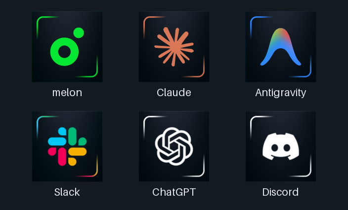

# Hexaza Custom

Stream Deck에서 사용하는 멜론, Claude, Antigravity, Slack, ChatGPT, Discord 아이콘 여섯 개를 담았습니다.



[최신 통합팩 다운로드](https://github.com/andrew427dev/hexaza-custom/releases/latest/download/local.hexaza.custom.streamDeckIconPack)

파일을 더블 클릭해 설치한 뒤 Stream Deck의 아이콘 라이브러리에서 **Hexaza Custom**을 선택해 주세요.

배경은 Piotezaza의 Hexaza 템플릿을 사용했습니다. [라이선스](local.hexaza.custom.sdIconPack/license.txt)

## 검증과 패키징

Python 3.11 이상에서 아래 명령을 실행해 주세요. Pillow는 미리보기 생성과 PNG 무결성 검사에 사용합니다.

```sh
python3 -m venv .venv
.venv/bin/python -m pip install -r requirements-build.txt
.venv/bin/python scripts/build.py --tag v1.0.1
```

`dist/`에 `local.hexaza.custom.streamDeckIconPack`, `preview.png`, `SHA256SUMS.txt`가 생성됩니다. 여섯 아이콘의 이름·파일·144×144 PNG 형식, 미리보기와 원본의 일치, 태그와 manifest 버전, 패키지 내부 파일을 검사합니다. 원본 아이콘의 바이트를 그대로 패키지에 넣습니다.

아이콘을 갱신할 때는 원본 PNG와 `icons.json`을 함께 수정하고 `manifest.json`의 버전을 올린 뒤, 다음 명령으로 미리보기를 갱신해 주세요. 미리보기는 `icons.json` 순서대로 같은 PNG를 배치하고 Pillow 내장 글꼴을 사용하므로 별도 운영체제 글꼴이 필요하지 않습니다.

```sh
.venv/bin/python scripts/build.py --update-preview
```

GitHub Actions는 푸시와 풀 리퀘스트마다 패키지를 검증합니다. 버전과 일치하는 `v1.0.1` 형식의 태그를 푸시하면 검사를 통과한 아이콘 팩·미리보기·체크섬을 릴리스에 올립니다. 릴리스 본문에도 여섯 아이콘의 미리보기가 표시됩니다.

배경의 출처는 Elgato Marketplace에서 배포된 Piotezaza의 **Hexaza 2.0.1**에 포함된 빈 아이콘 템플릿입니다. 기존 배경의 저작권·MIT 고지는 팩 안의 `license.txt`에 보존하며, 앱 로고와 상표는 해당 권리자의 소유입니다. [원작자 Piotezaza](https://www.twitter.com/piotezaza)
